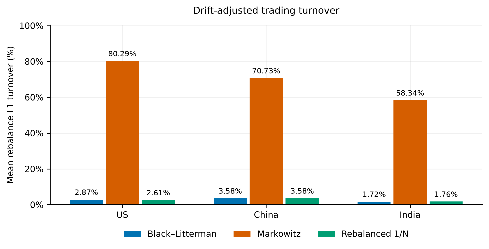

# Black–Litterman vs. Markowitz: Stability, Turnover, and Crisis Dynamics Across Global Markets

*An empirical comparison of portfolio construction methods using US-listed ETFs representing US, China and India equity exposures.*

**Amit Kumar Dudi** · [SSRN working paper](https://papers.ssrn.com/sol3/papers.cfm?abstract_id=6479462) · [Methodology](docs/METHODOLOGY.md) · [Complete results](docs/RESULTS.md) · [Reproducibility](docs/REPRODUCIBILITY.md)

## Research in brief

Historical-mean Markowitz optimization can produce concentrated portfolios and unstable target weights. This study evaluates whether an equilibrium-anchored Black–Litterman (BL) allocation reduces those implementation problems—and whether the improvement persists when compared with **rebalanced equal weighting (1/N)** and **Markowitz under matched concentration constraints**.

**Principal finding:** BL produces substantially more stable target allocations and lower modeled turnover than unrestricted Markowitz. Yet BL performs almost identically to periodically rebalanced 1/N, and the tested Sharpe-ratio differences do not establish significant superiority. The evidence supports a portfolio-stabilization interpretation, **not incremental Bayesian alpha**.

## Principal out-of-sample results

Net performance at **10 basis points per unit of L1 traded-weight turnover**. Annual returns are arithmetic annualized means; Sharpe uses a zero risk-free rate. Maximum drawdown includes starting wealth. Mean turnover excludes separately charged initial deployment.

| Exposure | Strategy | Net annual return | Sharpe | Max drawdown | Mean L1 turnover | Target ASI |
|:--|:--|--:|--:|--:|--:|--:|
| US | **Black–Litterman** | 15.41% | 0.807 | −35.07% | 2.87% | 0.009409 |
| US | Markowitz | 15.89% | 0.744 | −31.15% | 80.29% | 0.805060 |
| US | Rebalanced 1/N | 15.42% | 0.808 | −35.07% | 2.61% | 0 |
| China | **Black–Litterman** | 5.82% | 0.202 | −64.25% | 3.58% | 0.001479 |
| China | Markowitz | 4.53% | 0.150 | −65.26% | 70.73% | 0.712407 |
| China | Rebalanced 1/N | 5.82% | 0.202 | −64.26% | 3.58% | 0 |
| India | **Black–Litterman** | 10.87% | 0.504 | −49.74% | 1.72% | 0.002346 |
| India | Markowitz | 13.21% | 0.584 | −47.59% | 58.34% | 0.585259 |
| India | Rebalanced 1/N | 10.87% | 0.504 | −49.74% | 1.76% | 0 |

[Full-precision principal table](results/phase3_final/table_02_principal_performance.csv) · [Eight publication tables](results/phase3_final/FINAL_RESEARCH_TABLES.md) · [Supplementary research findings](outputs/final_professor_challenge_resolution/FINAL_RESEARCH_FINDINGS.md)

**Interpretation.** BL's small active deviations from 1/N are consistent with its equal-weight equilibrium proxy, mild historical-return views and high view uncertainty. A matched **40% individual-ETF target cap** substantially reduces Markowitz concentration and turnover. Risk-adjusted rankings remain market-dependent; the paired Sharpe bootstrap comparisons are not significant across tested block lengths. These are empirical findings under the stated investment rules, not claims of general strategy superiority.

## Study design

| ETF exposure | Instruments | Main out-of-sample period | Sessions |
|:--|:--|:--|--:|
| US | SPY, QQQ, IWM, XLF, XLK | 2011-01-04 to 2024-12-31 | 3,521 |
| China | ASHR, KWEB, MCHI, FXI | 2014-11-07 to 2024-12-31 | 2,553 |
| India | INDA, EPI, SMIN, INDY | 2013-02-13 to 2024-12-31 | 2,991 |

All instruments are **US-listed, USD-denominated ETFs**. These portfolios measure USD investor outcomes for selected country exposures, not comprehensive domestic-market performance or national market efficiency.

- **Allocation:** rolling 252-session estimation, 63-session rebalance schedule, Ledoit–Wolf covariance, risk aversion 3, long-only fully invested portfolios.
- **BL specification:** `Π = λΣw_eq`, with **equal-weight proxy** `w_eq` rather than observed market capitalization. Views are a 10% tilt toward training-window historical means, with explicitly modeled uncertainty.
- **Investment accounting:** holdings drift between trades; fees apply to actual drift-adjusted L1 trades, including initial cash deployment. **ASI** measures successive *target-weight changes*, not realized trading volume.
- **Comparators:** historical-mean Markowitz, periodically rebalanced 1/N, and matched 40%-cap robustness. Cost scenarios: 0, 5, 10 and 20 bps per L1 unit.
- **Inference:** paired circular-block Sharpe comparisons and exploratory decision-level ASI/turnover uncertainty. These analyses account for some serial dependence but are approximate and not adjusted for multiple comparisons.

[Detailed equations and conventions](docs/METHODOLOGY.md)

## Research figures

[](results/phase3_final/figures/01_cumulative_wealth.png)

*Compounded net wealth under the main 10-bps scenario. Arithmetic annualized return and final compounded wealth are distinct measures.*

| Allocation stability | Rebalance turnover |
|:--:|:--:|
| [](results/phase3_final/figures/02_allocation_stability.png) | [](results/phase3_final/figures/03_trading_turnover.png) |

[Matched concentration comparison](results/phase3_final/figures/04_matched_concentration.png) · [Transaction-cost sensitivity](results/phase3_final/figures/05_transaction_costs.png) · [Statistical uncertainty](results/phase3_final/figures/06_statistical_uncertainty.png) · [US factor exposures](results/phase3_final/figures/08_us_factor_exposures.png) · [Tau sensitivity](results/phase3_final/figures/09_us_tau_sensitivity.png)

## Robustness and what remains uncertain

| Check | Evidence | What it establishes or limits |
|:--|:--|:--|
| BL versus 1/N | [Posterior/active-weight diagnostics](outputs/final_professor_challenge_resolution/STAGE_A_IDENTIFICATION.md) | Strong equilibrium anchoring; no established incremental Bayesian investment gain |
| Markowitz 40% cap | [Matched concentration table](results/phase3_final/table_03_concentration_robustness.csv) | Part of the unrestricted stability gap reflects concentration; the cap was fixed for the revised analysis, not preregistered |
| Trading costs | [0/5/10/20-bps table](results/phase3_final/table_04_transaction_cost_sensitivity.csv) | Model-specific fee effects, not full market impact |
| Sharpe inference | [10/20/40-session block comparison](outputs/final_professor_challenge_resolution/stage_b_sharpe_blocks.csv) | No tested difference rejects the null at 5%; failure to reject is not equivalence |
| Decision-level inference | [ASI/turnover comparisons](outputs/final_professor_challenge_resolution/stage_b_decision_uncertainty.csv) | Few dependent observations, unadjusted tests; zero recorded Monte Carlo exceedances do not mean a true probability of zero |
| Common-calendar comparison | [2,553-session overlap](outputs/final_professor_challenge_resolution/stage_c_common_period.csv) | Reduces calendar differences, but does not equalize ETF exposures |
| Historical crisis stresses | [Conditional wealth-path reconciliation](outputs/final_professor_challenge_resolution/stage_b_crisis_reconciliation.csv) | Six outcomes reconcile conditional on archived weights; **original pre-event weight-selection timelines remain unavailable** |
| US factor regression and tau | [US OLS/HAC check](outputs/final_professor_challenge_resolution/stage_b_factor_audit.csv) · [Tau table](results/phase3_final/table_08_tau_sensitivity.csv) | Factor exposures and limited parameter sensitivity; neither establishes causality or predictive alpha |

**Data boundary.** Four frozen vendor-derived input files were hash-checked locally, but the raw snapshots and some derived caches are not in the public repository; redistribution rights are not assumed. Public CI tests synthetic financial identities and verifies committed evidence, **not a fresh full-market-data reproduction**. The revised results also do not reproduce the original March paper's exact historical data/model specification. [Evidence and reproducibility details](docs/REPRODUCIBILITY.md).

## Repository guide

| Start here | What it contains |
|:--|:--|
| [Methodology](docs/METHODOLOGY.md) | BL prior, view calibration, optimizer, portfolio accounting and inference |
| [Research results](docs/RESULTS.md) | Detailed findings, supplementary comparisons and research limitations |
| [Reproducibility](docs/REPRODUCIBILITY.md) | Environment, public checks, frozen-data boundaries and execution paths |
| [Research history](docs/RESEARCH_HISTORY.md) | March working-paper record, later revisions and archive provenance |
| [Final results index](results/final/README.md) | Authoritative tables, figures, supplementary diagnostics and current manuscript |
| [Source models](models/) · [Backtests](backtesting/) · [Tests](tests/) | Financial implementation and independently checkable numerical identities |

### Verify the published evidence

Requires Python 3.12. From the repository root:

```bash
python -m pip install -r requirements-phase1-lock.txt
python -m scripts.validate_publication
python -m unittest discover -s tests -v
```

These commands validate available public evidence and the synthetic test suite; they do not recreate the historical experiment from unavailable private inputs.

## Paper and version status

The [SSRN working paper (Abstract ID 6479462)](https://papers.ssrn.com/sol3/papers.cfm?abstract_id=6479462) is the currently posted historical version. Repository results reflect subsequent research revisions that have **not yet been uploaded to SSRN**. Author review and SSRN AI-policy clearance remain outstanding.

**Suggested citation:** Dudi, Amit Kumar (2026). *Black–Litterman vs. Markowitz: Stability, Turnover, and Crisis Dynamics Across Global Markets*. Revised research repository.

**Contact:** amitkumardudi04@gmail.com. The repository's [LICENSE](LICENSE) does not grant redistribution rights for third-party market-data inputs.
