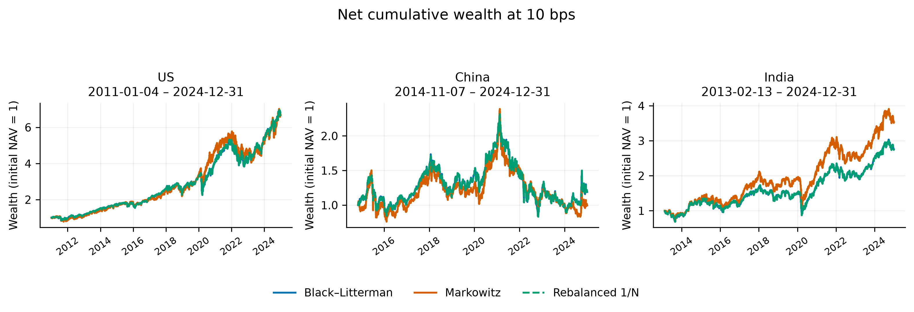
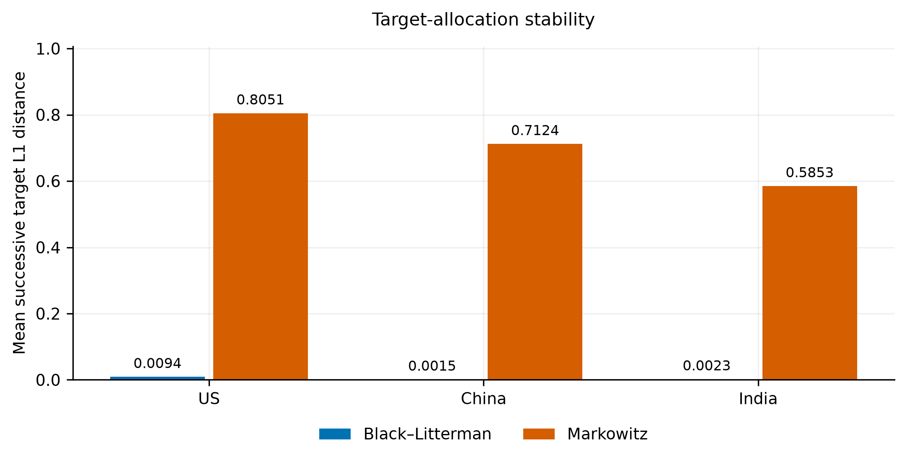

# Black–Litterman vs. Markowitz: Stability, Turnover, and Crisis Dynamics Across Global Markets

*An empirical study of portfolio stability, trading turnover and risk-adjusted performance across US-listed ETF baskets.*  
Researcher: **Amit Kumar Dudi**

## 1. Research overview

Historical-mean Markowitz optimization can amplify estimation error into concentrated, unstable allocations. Black–Litterman (BL) combines equilibrium-implied returns with views and their uncertainty, potentially stabilizing the resulting portfolio targets.

This experiment evaluates that stabilization against both historical-mean Markowitz and periodically rebalanced equal weighting. It separates target changes from actual drift-adjusted trades, and arithmetic returns from compounded investment wealth. Matched constraints and proportional trading costs make benchmark choice an explicit part of the comparison. The BL prior is an equal-weight proxy and the views are a mild historical-return tilt; this is not a test of independent analyst forecasts.

## 2. Research questions

Does BL reduce target instability and actual turnover? Does it improve investment outcomes beyond rebalanced 1/N? How much does a matched concentration cap change Markowitz? Do modeled fees alter rankings, and are Sharpe differences statistically established?

## 3. Data and methodology

| Exposure | US-listed ETFs | Main OOS period | Sessions |
|---|---|---|---:|
| US | SPY, QQQ, IWM, XLF, XLK | 2011-01-04–2024-12-31 | 3,521 |
| China | ASHR, KWEB, MCHI, FXI | 2014-11-07–2024-12-31 | 2,553 |
| India | INDA, EPI, SMIN, INDY | 2013-02-13–2024-12-31 | 2,991 |

Both optimizers use 252-session training windows, 63-session rebalancing, Ledoit–Wolf covariance, risk aversion 3, and long-only fully invested portfolios. BL reverse-optimizes an **equal-weight equilibrium proxy**, not observed capitalization weights, and applies a 10% historical-return view tilt with large view uncertainty. Holdings drift without interim rebalancing. Costs apply multiplicatively at trades, including initial deployment. L1 turnover measures target minus drifted pretrade weights; ASI measures successive target differences. Main Sharpe ratios use RF=0. These are USD investor returns through US-listed ETF proxies, not domestic local-currency national-index returns. [Full methodology](docs/METHODOLOGY.md).

## 4. Main empirical results

Net results at **10 bps per unit of L1 turnover**, from the [verified principal CSV](results/phase3_final/table_02_principal_performance.csv). Returns are annualized arithmetic means; drawdowns include initial NAV. Average turnover excludes initial cash deployment, which is charged separately. ASI is dimensionless.

| Market | Strategy | Net annual return | Sharpe | Max drawdown | Mean L1 turnover | ASI |
|---|---|---:|---:|---:|---:|---:|
|US|BL|15.4148%|0.806964|-35.0693%|2.8735%|0.009409|
|US|Markowitz|15.8896%|0.744400|-31.1532%|80.2868%|0.805060|
|US|1/N|15.4183%|0.807620|-35.0716%|2.6123%|0.000000|
|China|BL|5.8193%|0.202377|-64.2506%|3.5751%|0.001479|
|China|Markowitz|4.5276%|0.149513|-65.2639%|70.7290%|0.712407|
|China|1/N|5.8210%|0.202381|-64.2611%|3.5848%|0.000000|
|India|BL|10.8720%|0.503642|-49.7382%|1.7249%|0.002346|
|India|Markowitz|13.2072%|0.583735|-47.5871%|58.3411%|0.585259|
|India|1/N|10.8700%|0.503564|-49.7414%|1.7618%|0.000000|


## 5. Key findings

BL has substantially lower target instability and modeled turnover than unrestricted historical-mean Markowitz. It remains extremely close to rebalanced 1/N; incremental investment performance attributable to Bayesian updating is **not established**. A matched 40% target cap materially reduces Markowitz concentration and turnover. Risk-adjusted rankings vary across markets, and trading costs do not establish universal BL superiority.

Sharpe differences remain insignificant under tested approximate paired bootstraps. Exploratory decision-level BL-minus-Markowitz ASI and turnover intervals lie below zero under both caps, with only 40–55 paired decision differences. Serial dependence, multiplicity and finite simulation resolution limit inference: a reported Monte Carlo p=0 means no exceedances among the draws, not a true probability of zero. Stabilization is distinct from investment alpha. [Results and limitations](docs/RESULTS.md).

## 6. Robustness checks

| Check | Evidence and interpretation |
|---|---|
| Matched 40% target cap | [Concentration](results/phase3_final/table_03_concentration_robustness.csv); introduced in revised research before recorded Phase 2 execution, without preregistration evidence |
| Rebalanced 1/N | [BL active weights and tracking](outputs/final_professor_challenge_resolution/stage_a_diagnostics.csv); near-identical return paths |
| 0/5/10/20 bps costs | [Sensitivity](results/phase3_final/table_04_transaction_cost_sensitivity.csv); metric- and market-dependent rankings |
| Sharpe blocks 10/20/40 sessions | [Sensitivity](outputs/final_professor_challenge_resolution/stage_b_sharpe_blocks.csv); all intervals include zero, minimum p=.102 |
| Decision-level ASI / turnover | [Paired inference](outputs/final_professor_challenge_resolution/stage_b_decision_uncertainty.csv); limited dependent decision sample |
| Common-calendar period | [Results](outputs/final_professor_challenge_resolution/stage_c_common_period.csv); 2014-11-07–2024-12-31, 2,553 sessions; existing strategies sliced, not retrained |
| US factors | [Independent OLS/HAC check and supplementary 1/N](outputs/final_professor_challenge_resolution/stage_b_factor_audit.csv); conditional US exposures |
| Fixed tau | [Five settings](results/phase3_final/table_08_tau_sensitivity.csv); separate from adaptive training-only tau |
| Historical crisis stresses | [Reconstruction](outputs/final_professor_challenge_resolution/stage_b_crisis_reconciliation.csv); conditional on archived vectors, selection timeline missing |

## 7. Selected research figures

Verified source figures are retained without redrawing. The remaining figures are indexed in [results](docs/RESULTS.md).





[Trading turnover figure](results/phase3_final/figures/03_trading_turnover.png) · [Matched concentration figure](results/phase3_final/figures/04_matched_concentration.png)

## 8. Research limitations

Strong equal-weight anchoring and small overlapping ETF baskets limit generalization. Main samples differ in length; the common-calendar check does not equalize exposures. USD adjusted-price proxies do not isolate national-market efficiency or currency effects. Costs are stylized and bootstrap inference is approximate. Crisis reconstructions are conditional on recorded vectors because original pre-event selection histories are incomplete. Frozen raw snapshots remain private; redistribution permission is not established. Revised-study evidence does not exactly reproduce the original March numerical record.

## 9. Reproducibility

Python 3.12; use the recorded dependency lock. From the repository root:

```sh
python -m pip install -r requirements-phase1-lock.txt
python -m scripts.validate_publication
python -m unittest discover -s tests -v
python -m scripts.phase3_final_results --validate-only
```

The first validator works on public frozen evidence; add `--private-inputs` to check the four retained local vendor snapshots. [Reproducibility instructions](docs/REPRODUCIBILITY.md) distinguish public checks, vendor-dependent study execution and rebuilding tables/figures without portfolio reruns.

## 10. Paper and research version

The [SSRN working paper](https://papers.ssrn.com/sol3/papers.cfm?abstract_id=6479462) is the historical March version; the revised numerical findings have not been uploaded there. This repository contains later verified research and a [revised author-review manuscript](outputs/final_professor_challenge_resolution/FINAL_MANUSCRIPT.pdf). Author declarations and AI-policy clearance remain pending. [Research history and archives](docs/RESEARCH_HISTORY.md).

## 11. References and contact

Markowitz (1952), Black and Litterman (1992), Ledoit and Wolf (2004), and DeMiguel, Garlappi and Uppal (2009) motivate the design; full bibliographic entries appear in the manuscript. Suggested citation: Dudi, Amit Kumar. *Black–Litterman vs. Markowitz: Stability, Turnover, and Crisis Dynamics Across Global Markets*. Revised research repository, 2026.

Contact: amitkumardudi04@gmail.com (retained repository contact). The existing [LICENSE](LICENSE) applies to the repository as stated; it does not grant rights to third-party vendor data. Material AI assistance and pending human verification are disclosed in the manuscript.
